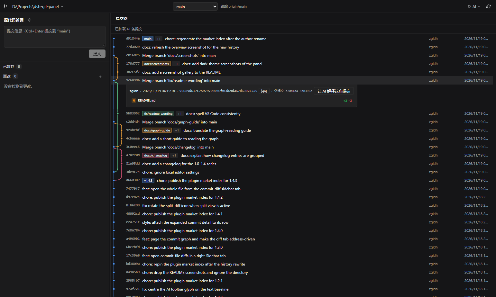

# dsh-git-panel

English | [中文](#中文说明)

A VSCode-style Git view for the [DeepSeek Harness](https://github.com/deepseek-ai/deepseek-harness) Web GUI. It lives next to **Chat** and **Trajectory** as a per-Session **Git** tab, so every Session operates on its own working directory — including Git repositories nested inside it.



## Features

- **Source control** — staged and changed file groups, per-file and whole-group stage/unstage, commit message with `Ctrl/Cmd+Enter`, branch switch, ahead/behind counts, refresh, and a unified diff view.
- **Commit graph** — newest commits with branch lanes; a lane keeps its colour for the whole branch line instead of changing at merge points. Branch refs collapse to the current branch plus a `+N` badge; the full list is in the commit detail.
- **Inline commit details** — click a commit to expand it below the row: author, time, full hash (copy button), parents, refs, changed files with `+N −M`, and an inline patch per file. One commit and one file expand at a time.
- **Aligned, resizable columns** — the author/time columns are aligned across rows and can be dragged (invisible 6 px hotspots, double-click resets); widths persist locally.
- **Resizable split** — the 1 px divider between the panes is always visible, highlights on hover, drags between 280 px and 70 % of the view, and resets on double-click.
- **Repository picker** — choose the Session working directory, the repository root, or any nested Git repository found below it (skips build/dependency directories).
- **State memory** — switching to Chat and back restores the selected repository, commit draft, open tab and file, expanded commit, and scroll positions (per Session, per browser tab).
- **AI prompts, not AI writes** — toolbar **AI** menu (merge branches, review current changes, explain the current branch), a review shortcut beside the source-control title, and **Explain this commit** in the commit detail. Each one generates an editable prompt and writes it into the composer with `inputActions.setDraft`; you press Enter to send. Prompts carry only the repository path, involved branches, and your stated purpose — the agent inspects the repository with its own tools.
- **Bilingual UI** (Chinese/English) and a light/dark theme that follows the host.

## Install

The bundle requires a DeepSeek Harness **Web** profile and `dsh >= 0.2.1-rc.3 < 0.3.0` (`engines.dsh` in `package.json`).

### From this Git repository

```sh
dsh plugin --profile web add github:zgldh/dsh-git-panel
```

Or open **Plugins**, add this repository as a bundle, and enable **Git Panel**.

### From the plugin market index

DSH has no official central marketplace; the supported mechanism is a plugin index — one JSON file served from any static host, which users add under **Plugins → Discover → Add index source**. This repository publishes such an index:

```
https://raw.githubusercontent.com/zgldh/dsh-git-panel/main/index.json
```

Add that URL as an index source, search for **Git Panel**, and install the listed version. The index pins an exact commit, so what you install matches this README.

### Local development

```sh
git clone https://github.com/zgldh/dsh-git-panel
dsh plugin --profile web add link:/path/to/dsh-git-panel
```

Restart `dsh web` once after installing or updating the host half. Client-only changes reload on refresh.

## Configuration

Edit the `git-panel` row in your profile patch (or the bundle's `cordis.patch.yml`):

| Key | Default | Meaning |
| --- | --- | --- |
| `logLimit` | `80` | Commits requested and drawn (10–300). |
| `commitFilesLimit` | `500` | Files listed in a commit detail (50–5000). |
| `includeAllRefs` | `false` | Draw all branches (`git log --all`). Keep `false` for a narrow graph on busy repositories. |
| `subrepoDepth` | `3` | How deep the picker searches for nested repositories (1–8). |
| `subrepoLimit` | `50` | Maximum nested repositories listed (1–300). |
| `skipDirectories` | build/dependency names | Directory names skipped while searching (case-insensitive). |
| `gitTimeoutMs` | `20000` | Timeout for one Git command. |
| `diffMaxChars` | `200000` | Maximum characters returned for one diff. |
| `signCommits` | `false` | Commit with `--no-gpg-sign` to avoid an interactive signing prompt. |
| `allowRoots` | empty | Optional fence: when non-empty, a repository root must live below one of these directories. |

## How it works

- **Host half** `index.js` registers one authenticated POST route `/api/git-ui` on the shared `/api` surface. It resolves a requested directory to its repository root with `git -C <dir> rev-parse --show-toplevel`, runs Git with an argument array (never a shell), validates repository-relative paths, and returns JSON envelopes.
- **Client half** `client.js` is a browser module loaded through the Harness client module loader. It registers the `conversation.view` slot (`id: 'git'`, order 20), reads the Session's working directory from the Session/Workspace snapshots, and renders the view with React (no build step, no JSX).
- **Display metadata** lives in `locale/zh.json`, `locale/en.json`, and `icon.svg`.

## Limitations

- Local operations only: no push/pull/fetch, discard, stash, or merge-conflict resolution.
- Branch switching lists local branches only; Git errors are shown verbatim.
- The commit graph is a simplified layout capped at 10 visible lanes; very branch-heavy histories clip the extra lanes.
- A merge commit's detail is compared against its **first parent**, matching GitHub's merge view.
- Column/split widths are stored globally in `localStorage`; view memory is per Session in `sessionStorage` (per browser tab).
- AI prompts are fill-only: the plugin never sends the message and never triggers a Git write operation. Commit-message generation is not implemented yet.

## Development

```sh
npm test                              # Host Git service tests + bundle checks
node scripts/build-index.mjs          # rebuild index.json
node scripts/build-index.mjs --check  # fail when index.json is stale
```

`scripts/build-index.mjs` validates its output with [`@deepseek-ai/dsh-plugin-market-index`](https://www.npmjs.com/package/@deepseek-ai/dsh-plugin-market-index) when that package is installed (CI installs it). The GitHub workflow rebuilds `index.json` after each push to `main`, so the market entry follows the code.

## License

[MIT](LICENSE) © 2026 zgldh

---

## 中文说明

DeepSeek Harness（DSH）Web GUI 的 VSCode 风格 Git 视图。它作为会话视图标签放在「对话」「轨迹」右边，名字是「Git」，按当前会话的工作目录工作；工作目录下面还有别的 Git 仓库时也能直接切过去。


### 功能

- **源代码管理**：已暂存/更改两组文件、单文件和整组暂存/取消暂存、提交信息（`Ctrl/Cmd+Enter` 提交）、分支切换、领先/落后提交数、刷新、文件 diff。
- **提交图**：分支泳道颜色跟着分支线走，合并点前后同色；分支标签压缩成当前分支加 `+N`，完整列表在提交详情里。
- **行内提交详情**：点提交行在下方展开——作者、时间、完整 hash（可复制）、父提交、refs、改动文件和每个文件的行内 patch；同时只展开一个提交、一个文件。
- **列对齐与可拖列宽**：作者/时间列统一对齐，列边界有 6px 隐形热区可拖动，双击复位，宽度记在本地。
- **可拖分栏**：左右分栏之间 1px 细线常显，悬停高亮，拖动范围 280px–视图 70%，双击复位。
- **仓库选择**：会话工作目录、仓库根目录、以及工作目录下任意一个下级 Git 仓库（跳过构建/依赖目录）。
- **状态记忆**：切到「对话」再切回 Git，会恢复所选仓库、提交草稿、当前标签和选中文件、展开的提交，以及滚动位置（按会话、按浏览器标签页）。
- **AI 只生成 prompt，不代替你操作**：工具栏「AI」菜单（合并分支、评审当前改动、解释当前分支）、源代码管理标题旁的评审按钮、提交详情里的「让 AI 解释这次提交」。生成可编辑的 prompt 并通过 `inputActions.setDraft` 填入输入框，由你按 Enter 发送；prompt 只给仓库路径、涉及分支和你的目的，让 AI 自己用工具查看仓库。
- 中英双语界面，深浅色主题跟随宿主。

### 安装

需要 DSH **Web** profile，`dsh >= 0.2.1-rc.3 < 0.3.0`（`package.json` 的 `engines.dsh`）。

```sh
dsh plugin --profile web add github:zgldh/dsh-git-panel
```

也可以打开 **插件** 页面，把这个仓库添加为 bundle，再启用 **Git 面板**。

**通过插件市场索引安装**：DSH 没有官方中央市场，官方支持的机制是「插件索引」——一个放在任意静态服务器上的 JSON 文件，用户在 **插件 → Discover → 添加索引源** 里添加。本仓库发布了一份这样的索引：

```
https://raw.githubusercontent.com/zgldh/dsh-git-panel/main/index.json
```

把上面的 URL 添加为索引源，搜索「Git 面板」，安装列出的版本即可。索引固定到具体 commit，装到的就是这份 README 描述的代码。

本地开发：

```sh
git clone https://github.com/zgldh/dsh-git-panel
dsh plugin --profile web add link:/path/to/dsh-git-panel
```

安装或更新 Host 部分后重启一次 `dsh web`；只改客户端时刷新页面即可。

### 配置

在 profile patch（或 bundle 的 `cordis.patch.yml`）里改 `git-panel` 行：

| 配置项 | 默认值 | 说明 |
| --- | --- | --- |
| `logLimit` | `80` | 请求并绘制的提交数（10–300）。 |
| `commitFilesLimit` | `500` | 提交详情里最多列出的文件数（50–5000）。 |
| `includeAllRefs` | `false` | 显示所有分支（`git log --all`）。仓库分支多时保持 `false`。 |
| `subrepoDepth` | `3` | 查找下级仓库的层数（1–8）。 |
| `subrepoLimit` | `50` | 最多列出的下级仓库数（1–300）。 |
| `skipDirectories` | 构建/依赖目录 | 查找下级仓库时跳过的目录名（大小写不敏感）。 |
| `gitTimeoutMs` | `20000` | 单条 Git 命令超时（毫秒）。 |
| `diffMaxChars` | `200000` | 单次 diff 返回的最大字符数。 |
| `signCommits` | `false` | 提交时带 `--no-gpg-sign`，避免卡在签名提示。 |
| `allowRoots` | 空 | 可选安全围栏：非空时仓库根目录必须落在其中某个目录下。 |

### 实现方式

- **Host 半** `index.js`：在共享 `/api` 上注册一条登录保护的 `POST /api/git-ui` 路由；用 `git -C <dir> rev-parse --show-toplevel` 把目录解析为仓库根目录；Git 以参数数组执行、不经过 shell；校验仓库内相对路径；返回 JSON。
- **Client 半** `client.js`：通过 Harness 客户端模块加载器加载的浏览器模块，注册 `conversation.view`（`id: 'git'`，order 20），从 Session/Workspace 快照读工作目录，用 React 渲染（无构建、无 JSX）。
- **显示元数据** 在 `locale/zh.json`、`locale/en.json`、`icon.svg`。

### 限制

- 只做本地操作：没有 push/pull/fetch、丢弃改动、stash、合并冲突处理。
- 分支切换只列本地分支；Git 报错原样显示。
- 提交图是简化布局，最多画 10 条泳道；分支特别多时部分泳道会被截掉。
- 合并提交的详情按**第一父**比较（与 GitHub merge 视图一致）。
- 列宽/分栏宽度存在 `localStorage`（全局）；视图状态按会话存在 `sessionStorage`（按浏览器标签页）。
- AI 只到「填 prompt」为止：不自动发送、不触发任何 Git 写操作；暂未实现「生成提交信息」。

### 开发与许可

```sh
npm test                              # Host Git 服务测试 + bundle 检查
node scripts/build-index.mjs          # 重建 index.json
node scripts/build-index.mjs --check  # 校验 index.json 是否过期
```

`scripts/build-index.mjs` 在安装了 `@deepseek-ai/dsh-plugin-market-index` 时会用官方校验器验证输出（CI 会安装）。GitHub workflow 会在每次 push 到 `main` 后重建 `index.json`，市场条目随之更新。

[MIT](LICENSE) © 2026 zgldh
